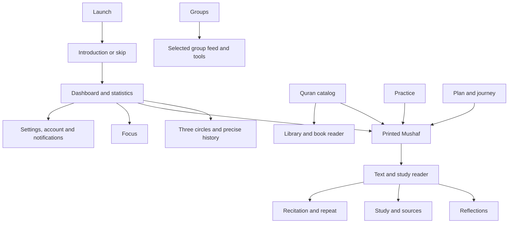

# Quran Tracker — screen and flow plan

This implementation-aware UX plan was updated on 14 November 2026 against the six supplied original screenshots and the Kotlin source. The current F24 assessment, fresh native measurements and concrete source differences are in [UI/UX and parity review](UI_UX_REVIEW_F24.md). Audit checkpoint F25 did not change or rebuild the application. The local `design-preview/index.html` board uses app captures; it is not a Figma file or proof that every state has been device-tested. Capture captions distinguish build and test state. PRODUCT.md and DESIGN.md define the product and visual direction.

## Current assessment and the route to a 10

The current F24 experience is assessed at **approximately 6/10**. The earlier 4/10 described the F6c–F11 period; it is not the current rating. This remains an expert design judgment, not a test-derived satisfaction score or completed usability study. Independent design/native/source reviews found substantial improvements in reading, language access, navigation and opaque statistics surfaces, but also an overcrowded reader, insufficient prominence for the original statistics and concrete source-parity differences. On the reviewed phone, the landscape book viewport occupied only 37% of screen height; the first portrait text verse began at y=1988 of 2400. The current [review and execution order](UI_UX_REVIEW_F24.md) separates these measured layout issues, ten source differences and additional product requests. A full lexicon and complete native community/iOS acceptance remain open. Passing builds alone do not establish a finished experience.

The table below records earlier before/after contracts, not a claim that every original defect is still present. Current evidence and limitations take precedence in the linked F24 review.

| Before | After | Acceptance |
| --- | --- | --- |
| Normal Book/Text and resume routes can return to a nonselectable PDF without making that distinction clear. | One durable presentation choice; normal Hafs book entry is selectable, explicitly chosen scans remain named originals, and Warsh retains its recitation. | Dock, Continue, Book/Text, return and cold launch all produce the chosen view and correct canonical position; PDF page numbers never become Hafs page numbers. |
| Selection is isolated to native line views. | One native selection buffer spans the book's prescribed lines. | Select letters, cross a line boundary, copy/paste exact Arabic and still tap a word separately. Verify actual device behavior. |
| A tall stack of controls shrinks the book; Dutch translation is buried. | Compact reader controls, a width-fitted book, visible Dutch/English translation and full original verses available offline. | Read the page in portrait/landscape, open its Dutch translation immediately, switch English and return to the same verse without needing to decipher Arabic. |
| Timed perspective/skew animations restart independently of the finger. | Actual scroll position controls a single-axis card fold with a flat readable region and reversible progress. | Slow drag, hold, reverse and fling; no timed movement after the finger stops, no overlapping controls, reduced motion stays flat. |
| Group posts and threaded replies are easy to overstate as a complete live chat. | Clearly identify the delivered conversation model and establish its refresh/pagination/offline behavior. | Two isolated test accounts exercise create/join, group isolation, post/reply/reaction/edit/delete, role denial, retry and notification targets through the native UI. |

The sequence is reading correctness and Dutch access first, then complete community acceptance, then shared typography/spacing/navigation and accessibility polish. The final review must cover real phone widths, long Dutch/Arabic labels, RTL, large text, landscape, offline states and return navigation across the core flows. A 10 is earned by the integrated experience, not by adding motion or decoration to unresolved interactions. The full dictionary and live-chat expectations require their own finished, sourced and tested flows; a contextual English word gloss or refreshed feed cannot stand in for them.

### What the finished experience must demonstrate

1. **Statistics lead the product.** At the first glance, distinguish today's goal, cumulative reading and the chosen period. The circular charts must answer both how much and what was read; tapping a segment leads to its actual history. Keep the reading plan independent of the daily goal. Use one spacing rhythm, clear units and a useful empty state.
2. **Reading needs no Arabic-language navigation knowledge.** The primary book opens the saved reference. Its visible language action opens the full original Dutch or English translation; text mode provides continuous reading. Selection, copy, word information and the future dictionary are distinct actions. Returning, rotating and restarting preserve the chosen presentation and reference.
3. **Groups feel like a complete conversation.** The selected group is always identifiable. Posting, replying, new content from another member, refresh, failed sends, draft retention and permissions need a coherent UI with two-account acceptance. The current feed and reply sheets must not be presented as a delivered realtime chat.
4. **The Arabic visual identity belongs to every screen.** Use the same type hierarchy, manuscript proportions, cypress/paper/clay palette, meaningful custom glyphs and consistent sheets across statistics, reader and groups. Any translucent Arabic background lettering stays behind content, noninteractive and decorative; it cannot reduce contrast or replace curated text. The dock needs a clear active destination and legible labels, with no duplicate ambiguous routes.
5. **Motion feels attached to the gesture.** Actual cards fold toward a flat reading position as they enter, stop when the finger stops and reverse when it reverses. Resting content remains readable and controls never overlap. Reduced motion removes the fold. A native recording is required before calling this accepted.

For the final usability review, observe a Dutch-only reader completing five tasks without explanation: understand the statistics, resume the book, find its Dutch translation, select/copy a passage and reply within the intended group. Record every wrong turn or missing feedback and correct it. Repeat with an Arabic reader, large text and landscape. This is a proposed acceptance exercise, not a study already performed or a guaranteed numerical score.

## Design intent

The three primary destinations are Statistics, printed Mushaf and Groups. Statistics answers how much was read and exactly what was read. The dashboard retains the daily-goal and independent reading-plan rings, with a prominent direct action to the three distribution charts and history. Mushaf resumes the chosen presentation at a verified reference: selectable Hafs by default for Hafs-family editions, or an explicitly chosen original scan/PDF. Warsh retains its own edition. Study, notes and audio are secondary reading tools. Groups opens the user's groups and their separate feeds. Cypress, warm paper and clay connect these screens; Arabic stays legible and the text reader remains independently scalable.

## Screen inventory and navigation

- **Launch and onboarding:** storage loading and retry, introduction, language selection and skip. Completion opens the main tabs.
- **Dashboard and statistics:** daily-goal ring and quick check-in, independent reading-plan ring, period-filtered distribution circles, precise history, Hizb timeline, coverage and independent Hifz scores. Open the chart overview directly from the top of the dashboard.
- **Quran catalog:** search and browse surahs, juz, hizb, rub and saved places. Reading actions open the printed Mushaf at the correct target. The text reader and book library remain separately reachable.
- **Text reader:** search, jump, bookmark, share, reflect on and study an ayah; reader settings, reciter, repeat and offline audio; check in and previous/next surah. Preserve the plan or reading-target context when switching into the Mushaf.
- **Mushaf:** original printed pages, saved edition/page, zoom, page jump, bookmarks and paging; two-page spreads on wide screens. Select a mapped ayah for text, reflection or study. Only explicit registration records reading, using trustworthy edition-specific reference mapping. Unmapped PDFs offer manual check-in rather than invented page ranges.
- **Study, sources and library:** word-by-word, grammar and similar passages for the selected ayah, source providers, book browsing, chapter/page navigation and search.
- **Practice:** select units for check-in, open readings, rate recall and switch among hizb, juz, rub and surah. Statistics, focus and checklist are separate screens.
- **Plan:** calendar, dated readings, individual plan and journey creation. A plan opens the relevant reading or can be checked off. Checklist is accessible from the header.
- **Groups:** source create/join/invitation flows, then a group-specific feed with author identity, timestamps, pinned posts, reactions and collapsed discussion threads. Secondary panels provide membership, permissions, media, tasks, events, reading progress, rules, notices, moderation and audit. Account and group features depend on configured services and sign-in; local reading remains available without them.
- **Settings, account and notifications:** appearance, language, reading preferences, import/export, device/account options, authentication, profile and notification preferences. Auth and group deep links enter their respective flows.
- **Reflections:** create, edit, find and export notes, including ayah-associated notes. Reader and Today provide entry points.
- **Global audio and recovery:** mini-player persists outside the reader while active. Launch/storage and unexpected-screen errors have recovery affordances.

## Flow contracts

| Flow | Primary task and feedback | Empty, loading and error | Accessibility and responsive intent |
| --- | --- | --- | --- |
| Start and resume | Select language or skip; resume the saved cursor in one action. | Storage loading is explicit; failure offers retry. A new reader gets a meaningful starting point. | Announce controls and steps; preserve readability and reachability on small phones. |
| Find and read | Search or browse a real reference; open the exact ayah, adjust Arabic size and translation, save a place or check in. | No match explains alternatives; content failure should be recoverable without losing position. | Arabic remains readable at large type; icon actions have names; avoid clipping with large system text and RTL. |
| Printed page and study | Open a page, change edition or jump; select a mapped ayah, then read, reflect or study. | Missing page/data or unavailable source is identified; never substitute invented text. | Image-based verse selection needs an accessible alternative; zoom and paging need named controls. |
| Listen | Choose a real reciter, play/pause, repeat or download; show active track and download progress. | Explain unavailable audio and download errors; reading stays usable offline. | Player controls need labels and status announcements; test interruption and background playback on devices. |
| Reflect and library | Write or edit a reflection, associate an ayah and find it again; browse or search books. | Explain first-use and no-match states; import/export failures preserve local data. | Inputs need labels, keyboard-safe layout and save feedback. Long Arabic and book text must wrap. |
| Practice and plan | Record actual reading or recall; select a date and create a reading or journey. | Empty dates offer an add action; invalid dates, duplicate entries and ranges explain correction. | Checkbox state, date and selected unit must be announced; destructive actions need confirmation or undo. |
| Circle and account | Sign in, create/join with a code, then manage a real group. | Distinguish unconfigured services, signed-out, loading, empty and network failure. Never present fake success. | Associate errors with fields; password controls and dialogs need explicit labels and focus order. |
| Settings and notifications | Adapt reading, appearance and language; import/export and choose notification preferences. | Explain unavailable services and denied permissions; preserve data on failure. | Verify RTL, dynamic type, contrast and assistive technology; do not rely on color alone. |

## Before → after decisions

1. Reading statistics were missing or buried → restore the original rings, precise ranges and grouped history, with a direct overview action at the top of the dashboard.
2. The text reader displaced the printed book → make the original Mushaf the primary reading destination, with named controls and separate study tools.
3. Empty screens can look broken → explain the first useful action in bookmarks, notes, plans and groups, using actual state.
4. Progress can feel punitive → use neutral counts and optional recall scoring; never prefill fabricated success.
5. Remote features can appear functional before provisioning → distinguish unconfigured, signed-out, offline and error states.
6. Complex planning can hide intent → show the selected date and validate ranges and duplicates at entry; keep the reading one tap away.

## Prioritized remaining checks and gaps

- **P1 — device and accessibility validation:** exercise actual iOS and Android devices, screen readers, large text, RTL, keyboard/safe areas, rotation, offline and audio interruption. These captures do not prove device parity.
- **P1 — remote provisioning:** isolated local API/RLS/storage tests have passed; complete native authenticated groups review separately. Hosted OAuth and physical FCM/APNs delivery remain deployment/device checks.
- **P1 — destructive actions:** verify plan removal and undo preserve the intended plan data.
- **P2 — small widths:** verify long translated labels, segmented controls and sheets at 320 px. The original Home capture shows the chapter title wrapping at the hyphen.
- **P2 — tablet composition:** the 1024 × 768 web capture stays readable but stretches the hero and bottom tabs widely; test native tablet ergonomics and consider a narrower measure or adaptive navigation.
- **P2 — recoverability:** test loading, import/export, offline audio, source availability and storage failures; preserve context and saved work.
- **P2 — precision and meaning:** validate accessible verse selection on the image-based Mushaf, keyboard traversal and status announcements for progress and playback.
- **P3 — visual polish:** inspect current native builds of notes, study, forms and sheets after the latest changes. Existing web captures are a timestamped baseline and may not show the newest code.

## Visual references

The direction borrows the calm hierarchy and reading-led presentation of [Quran Community App UI Design](https://dribbble.com/shots/26971005-Quran-Community-App-UI-Design-Modern-Islamic-Mobile-App-UX) and the paced introduction of [Quran App Onboarding UI](https://dribbble.com/shots/27041454-Quran-App-Onboarding-UI-Peaceful-Islamic-Mobile-Experience). These are references for hierarchy and craft, not copied assets or product claims.
